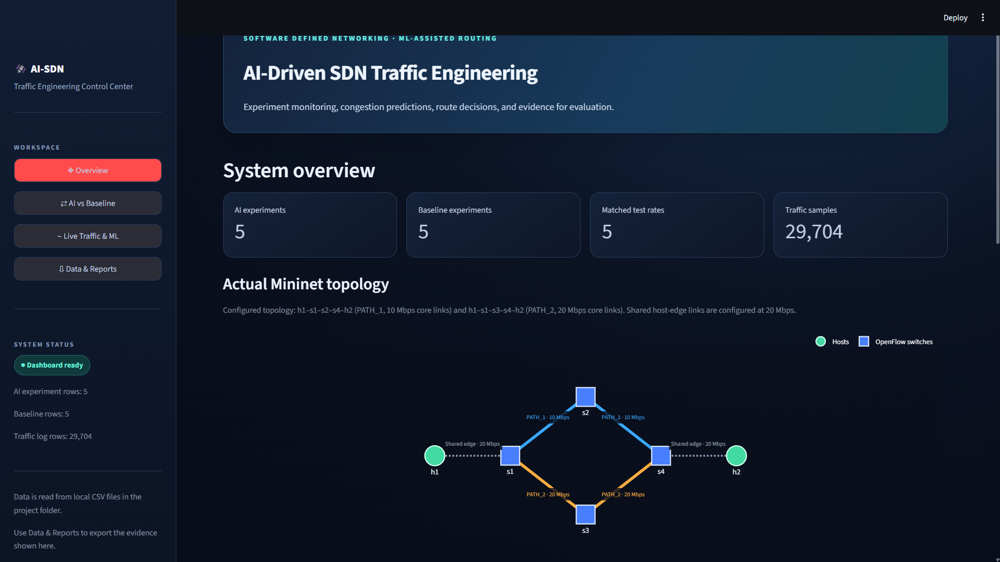

# AI-Driven-SDN-Traffic-Engineering
AI-driven SDN traffic engineering using Ryu, Mininet, Machine Learning, GNN forecasting and Streamlit.
# AI-Driven Traffic Engineering Framework for Software Defined Networks (SDN)

An AI-assisted Software Defined Networking (SDN) framework that monitors network traffic, forecasts potential congestion, and supports traffic engineering decisions using machine learning and a Ryu-based SDN controller.

## Project Overview

Traditional network routing generally follows predefined routing paths. However, changing traffic conditions can cause congestion, increased latency, and packet loss.

This project explores how Software Defined Networking (SDN), traffic monitoring, and AI-based forecasting can work together to support better network traffic engineering decisions.

The framework uses Mininet to emulate an SDN network, Ryu as the OpenFlow controller, and a Streamlit dashboard to monitor network activity and compare AI and Baseline routing modes.

## Key Features

- **SDN Network Emulation:** Uses Mininet to create and test a multi-switch network topology.
- **Centralized Network Control:** Uses a Ryu controller to manage the emulated network through OpenFlow.
- **Live Traffic Monitoring:** Collects network telemetry such as traffic rates and link utilization.
- **ML-Based Traffic Analysis:** Uses trained machine learning models to analyze network traffic conditions.
- **GNN-Based Traffic Forecasting:** Includes a forecasting module for predicting future switch utilization using historical and current telemetry.
- **AI-Assisted Traffic Engineering:** Uses traffic conditions and forecasting information in the AI routing mode.
- **Baseline Comparison:** Provides a Baseline mode for comparison with the AI mode.
- **Interactive Dashboard:** Uses Streamlit to display topology, telemetry, predictions, and experiment results.
- **Experiment Logging:** Records test results and supports CSV export.

## System Architecture

The framework consists of the following components:

1. **Mininet:** Creates a virtual SDN network for experimentation.
2. **Ryu Controller:** Communicates with OpenFlow switches and manages routing behaviour.
3. **Traffic Monitoring:** Collects network measurements from the emulated environment.
4. **ML and Forecasting Modules:** Analyze traffic conditions and estimate future utilization.
5. **Traffic Engineering Logic:** Uses the available traffic information to support routing decisions.
6. **Streamlit Dashboard:** Presents network status, predictions, and experiment results.

## Network Topology

The experimental topology contains four OpenFlow switches and two hosts.

```text
                  h1
                   |
                  s1
                 /  \
                s2  s3
                 \  /
                  s4
                   |
                  h2
```

Two paths are available between the source and destination:

- **PATH_1:** s1 → s2 → s4
- **PATH_2:** s1 → s3 → s4

The two paths provide an environment for observing traffic conditions and evaluating routing behaviour.

## Routing Modes

### 1. AI Mode

AI mode uses traffic information and available forecasting outputs as inputs to the traffic engineering decision process.

The controller evaluates path-related information and applies its routing policy to determine whether a path should be retained or changed.

### 2. Baseline Mode

Baseline mode provides a reference for evaluating the AI-assisted approach. It uses the predefined PATH_1 routing path.

Both modes can be evaluated under comparable traffic-generation conditions.

## Technology Stack

| Component             | Technology                                  |
| --------------------- | ------------------------------------------- |
| Programming Language  | Python                                      |
| SDN Controller        | Ryu                                         |
| Network Emulator      | Mininet                                     |
| Network Protocol      | OpenFlow                                    |
| Dashboard             | Streamlit                                   |
| Data Processing       | Pandas, NumPy                               |
| Machine Learning      | Scikit-learn and configured model libraries |
| Forecasting           | GNN-based forecasting module                |
| Visualization         | Plotly                                      |
| Model Storage         | Joblib                                      |
| Operating Environment | Ubuntu / WSL2                               |

## Project Structure

```text
AI-Driven-SDN-Traffic-Engineering/
│
├── dashboard_v6_control_center.py
├── ai_traffic_engineering.py
├── run_experiments.py
├── dashboard_network_helper.py
├── gnn_live_predictor.py
│
├── traffic_forecaster_v2.joblib
├── experiment_results_ai.csv
├── experiment_results_baseline.csv
│
├── requirements.txt
├── README.md
├── .gitignore
│
└── screenshots/
```

Note: The exact model artifacts and supporting files depend on the configuration used in the project. Include all files required by the Python imports and model-loading code.

## Installation and Setup

### Prerequisites

- Ubuntu Linux or Ubuntu through WSL2
- Python 3
- Mininet
- Open vSwitch
- Ryu controller
- iperf
- Git

Mininet, Open vSwitch, and iperf are system-level dependencies and should be installed separately from the Python packages.

### 1. Clone the Repository

```bash
git clone https://github.com/KunalSharma305/AI-Driven-SDN-Traffic-Engineering.git
```

```bash
cd AI-Driven-SDN-Traffic-Engineering
```

### 2. Create a Virtual Environment

```bash
python3 -m venv ryu-env
```

Activate it:

```bash
source ryu-env/bin/activate
```

### 3. Install Python Dependencies

```bash
pip install -r requirements.txt
```

Some dependencies may require additional system libraries or version-specific installation steps.

### 4. Start the Ryu Controller

The controller must be started with the appropriate routing mode.

For AI mode:

```bash
SDN_ROUTING_MODE=ai ryu-manager ai_traffic_engineering.py
```

For Baseline mode:

```bash
SDN_ROUTING_MODE=baseline ryu-manager ai_traffic_engineering.py
```

The controller listens on OpenFlow port **6633** in the configured setup.

### 5. Start the Dashboard

Open another terminal:

```bash
cd AI-Driven-SDN-Traffic-Engineering
source ryu-env/bin/activate
streamlit run dashboard_v6_control_center.py
```

The Streamlit dashboard will provide the interface for observing network telemetry, predictions, and experiment results.

### 6. Run Experiments

Use the experiment runner to evaluate the routing modes.

AI mode:

```bash
python run_experiments.py --mode ai
```

Baseline mode:

```bash
python run_experiments.py --mode baseline
```

The experiment runner uses the Mininet environment and its configured traffic-generation parameters.

**Important:** Start the required controller and network services before running experiments. Follow the project's configured Mininet startup and cleanup workflow.

## Evaluation Metrics

The framework can be evaluated using network performance measurements such as:

- Throughput
- Network utilization
- Traffic rate
- Latency
- Packet loss
- Traffic forecasting error
- Routing behaviour
- AI versus Baseline performance

Actual performance improvements should be determined from experimental results rather than assumed.

## Experimental Results

The repository may include CSV files containing the recorded results of AI and Baseline experiments.

These files can be used to:

- Compare network performance under different traffic loads.
- Observe utilization changes.
- Analyze routing behaviour.
- Evaluate prediction performance.
- Generate performance graphs and reports.

## Dashboard

The dashboard provides a visual interface for observing the emulated SDN network.

Add screenshots of your actual running dashboard in the `screenshots/` directory.

Example:

```text
screenshots/
├── dashboard.png
├── topology.png
└── experiment_results.png
```

You can display a screenshot here by adding:

```markdown

```

## Limitations

- The framework is evaluated in an emulated Mininet environment rather than a production network.
- Forecasting accuracy depends on the quality and availability of telemetry and trained models.
- Routing decisions depend on the configured controller policy.
- Network behaviour in an emulated environment may differ from real-world network conditions.
- AI mode should not be assumed to outperform Baseline mode without experimental evidence.

## Future Scope

Potential future improvements include:

- Further development of topology-aware GNN models.
- Improved traffic forecasting accuracy.
- More advanced congestion-aware path selection.
- Evaluation on larger network topologies.
- Additional experiments under different traffic patterns.
- Testing with real-world network traffic traces.

## Author

**Kunal Sharma**

B.Tech – Artificial Intelligence

Madhav Institute of Technology and Science (MITS), Gwalior

## License

This project is intended for academic and educational purposes.
